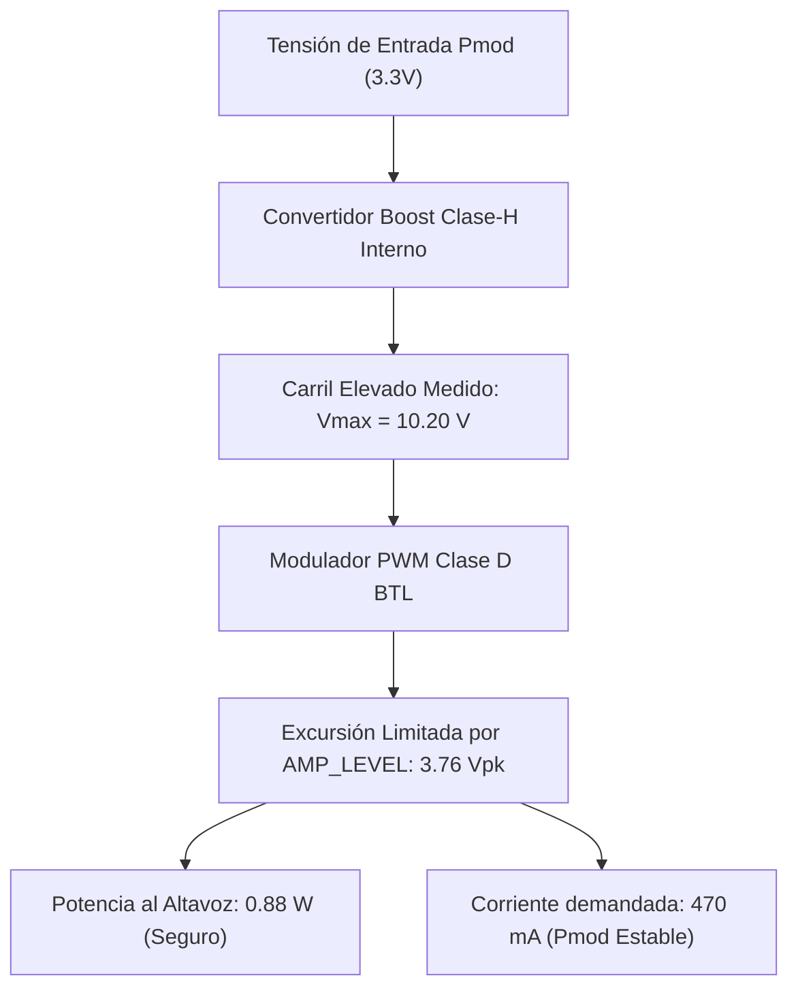

# Informe Técnico de Caracterización Experimental (TFM)
**Plataforma de Desarrollo:** Digilent Nexys 4 DDR (Xilinx Artix-7 XC7A100T-1CSG324C)  
**Periférico de Audio:** Texas Instruments TAS2110 (Amplificador Clase D Digital con Boost Clase-H de 11V)  
**Instrumentación:** Osciloscopio Digital Hanmatek DOS1102 (110 MHz, 1 GSa/s)  
**Repositorio/Proyecto:** `Prueba1_demo_v2.1`  

---

## Resumen Ejecutivo
El presente informe documenta los ensayos de caracterización física y validación de integridad de señal realizados en el laboratorio sobre dos subsistemas críticos del diseño:
1. **Prueba 1: Bus de Comunicaciones I²C (Línea de Reloj SCL e Integridad de Señal).** Justificación teórico-práctica del uso de topología *Push-Pull* frente al estándar de drenador abierto, demostración analítica del fallo del pull-up interno de la FPGA y validación experimental del tiempo de subida ($t_r = 36\,\text{ns}$) y frecuencia ($f = 100\,\text{kHz}$).
2. **Prueba 2: Etapa de Potencia de Audio BTL y Ganancia Analógica (TAS2110).** Metodología de medida diferencial pseudo-diferencial en carga en puente (BTL), caracterización de la modulación PWM conmutada, verificación empírica del convertidor Boost a $10.20\,\text{V}$ y justificación analítica del punto óptimo de ganancia en el registro `PB_CFG1` (`AMP_LEVEL = 01h`, $3.76\,\text{V}_{pk}$) para evitar distorsión mecánica en el altavoz de $1\,\text{W}$ y prevenir el reseteo por caída de tensión (*Brown-Out Protection*, BOP) en el puerto Pmod de la FPGA.

---

# PARTE 1: Caracterización del Bus I²C (Reloj SCL)

## 1.1. Contexto de Arquitectura y Código VHDL
En el archivo [`tas2110_i2c_ctrl.vhd`](file:///C:/Users/kille/Documents/GitHub/TFM-UPM/Practica/Prueba1_demo_v2.1/Prueba1_demo_v2.1.srcs/sources_1/new/tas2110_i2c_ctrl.vhd#L58-L64) y [`top_system.vhd`](file:///C:/Users/kille/Documents/GitHub/TFM-UPM/Practica/Prueba1_demo_v2.1/Prueba1_demo_v2.1.srcs/sources_1/new/top_system.vhd#L30-L31):
* El puerto `i2c_scl` está definido como salida unidireccional pura: `i2c_scl : out STD_LOGIC`.
* En la arquitectura se asigna directamente la señal activa: `i2c_scl <= scl_out`.
* En las restricciones físicas ([`Nexys4DDR.xdc`](file:///C:/Users/kille/Documents/GitHub/TFM-UPM/Practica/Prueba1_demo_v2.1/Prueba1_demo_v2.1.srcs/constrs_1/new/Nexys4DDR.xdc#L91)), el pin está configurado como `IOSTANDARD LVCMOS33 PULLUP true` en el puerto Pmod JB pin 1 (`D14`).

La FPGA excita la línea SCL de forma **Push-Pull (Tótem-Pole)** con un driver CMOS de 3.3V, conduciendo activamente tanto el nivel bajo ($0\,\text{V}$) como el nivel alto ($3.3\,\text{V}$).

---

## 1.2. Análisis Teórico y Normativo: ¿Es correcto usar Push-Pull?

### A. La Norma Oficial (NXP UM10204 I²C-bus Specification)
El estándar I²C exige que las líneas SDA y SCL sean de **colector/drenador abierto (Open-Drain)** con resistencias de elevación (*pull-up*) pasivas a $V_{DD}$ por tres motivos fundamentales:
1. **Evitar cortocircuitos en colisión multi-maestro** (lógica cableada *Wired-AND*).
2. **Permitir *Clock Stretching*:** Cualquier esclavo que requiera tiempo adicional puede retener SCL a nivel bajo. Si el maestro fuerza un '1' en Push-Pull mientras el esclavo retiene '0', se produce contención de bus (*short-circuit* entre $V_{DD}$ y GND).
3. **Bidireccionalidad segura de SDA.**

### B. Justificación de Ingeniería del Diseño Implementado
Aunque Push-Pull es formalmente no conforme con la especificación genérica I²C, en este sistema es **técnicamente óptimo y plenamente seguro** debido a tres factores:
1. **Arquitectura Maestro Único - Esclavo Dedicado:** La FPGA es el único emisor sobre SCL.
2. **Esclavo TAS2110 sin Clock Stretching:** Según el datasheet de Texas Instruments, el pin SCL del TAS2110 es **estrictamente de entrada (High-Z)**. El dispositivo jamás excita la línea SCL a nivel bajo. Por tanto, no existe ningún riesgo de contención de bus. SCL opera eléctricamente idéntico a un reloj síncrono SPI.
3. **Limitación de Hardware de la Placa Digilent Nexys 4 DDR:** Los conectores Pmod de la placa no disponen de resistencias de pull-up externas de $2.2\,\text{k}\Omega - 4.7\,\text{k}\Omega$.

### C. Demostración Matemática: Por qué el Pull-Up Interno de la FPGA Fracasa
Si se hubiera implementado drenador abierto estándar confiando únicamente en el pull-up interno de la FPGA Artix-7 (`PULLUP true`):
* Resistencia interna Artix-7 (*Xilinx UG471 / DS181*): $R_{PU} \approx 15\,\text{k}\Omega \text{ a } 25\,\text{k}\Omega$ (valor nominal: **$20\,\text{k}\Omega$**).
* Capacidad parásita estimada del bus (pistas Pmod, cables jumper, pines FPGA y TAS2110, sonda): $C_{bus} \approx \mathbf{70\,\text{pF}}$.

El tiempo de subida normativo I²C (medido del 30% al 70% de $V_{DD}$) en un circuito $RC$ es:
$$t_r = \ln\left(\frac{1 - 0.3}{1 - 0.7}\right) \times R_{PU} \times C_{bus} = \ln\left(\frac{0.7}{0.3}\right) \times R_{PU} \times C_{bus} \approx 0.8473 \times R_{PU} \times C_{bus}$$

Sustituyendo valores:
$$t_r = 0.8473 \times 20\,000\,\Omega \times 70 \times 10^{-12}\,\text{F} \approx \mathbf{1186\,\text{ns}} \quad (\mathbf{1.19\,\mu\text{s}})$$

> [!WARNING]
> La norma I²C UM10204 para *Standard-mode* fija un límite máximo de **$t_{r,max} = 1000\,\text{ns}$ ($1\,\mu\text{s}$)**.
> Con $1.19\,\mu\text{s}$, el flanco de subida incumple la norma. Además, al durar el semiperiodo alto solo $5.0\,\mu\text{s}$, la onda se deformaría en "aleta de tiburón", dejando el nivel lógico alto inestable y causando fallos de sincronismo en el TAS2110.

Al forzar **Push-Pull**, la resistencia de carga pasa a ser la impedancia del transistor PMOS de la FPGA sumada a la resistencia serie de protección integrada en el Pmod de la placa Nexys ($R_{serie} = 200\,\Omega$):
$$t_{r,teorico} \approx 2.2 \times (R_{on} + R_{serie}) \times C_{bus} \approx 2.2 \times (25\,\Omega + 200\,\Omega) \times 70\,\text{pF} \approx \mathbf{34.6\,\text{ns}}$$

---

## 1.3. Procedimiento Experimental de Laboratorio (Prueba 1)

### Instrumentación y Configuración Física
* **Canal:** CH1 conectado al **Pmod JB, Pin 1 (`D14` - SCL)**.
* **Masa:** Pinza de cocodrilo conectada al **Pmod JB, Pin 5 / 11 (GND)**.
* **Ajuste de Sonda (Crítico):** Sonda física conmutada a **`10X`** y menú del osciloscopio en **`Probe: 10X`**. *(A 1X el ancho de banda decae a 6 MHz y la capacidad sube a 100 pF, falseando totalmente la medida).*

### Ajustes del Osciloscopio Hanmatek DOS1102


1. **Captura 1A (Protocolo y Frecuencia):**
   * Base de tiempos horizontal: **`5 µs/div`** (o `10 µs/div`).
   * Escala vertical CH1: **`1 V/div`** (referencia de 0V situada a 1 división del fondo).
   * Menú `Measure` activado: `Freq`, `Period`, `+Width`, `-Width`.
2. **Captura 1B (Integridad de Señal y Tiempo de Subida $t_r$):**
   * Base de tiempos horizontal: **`20 ns/div`** (o `50 ns/div`).
   * Desactivar CH2 para garantizar el conversor ADC a la velocidad máxima de **`1 GSa/s`** (resolución de 1 ns por muestra).
   * Medida de $t_r$ mediante `Measure -> Rise Time` y validación con Cursores temporales ($\Delta T$).

---

## 1.4. Resultados Experimentales Obtenidos

* **Tiempo de Subida Medido ($t_r$):** **$\mathbf{36\,\text{ns}}$**
* **Frecuencia del Reloj ($f_{SCL}$):** **$\mathbf{100.0\,\text{kHz}}$** ($T = 10.0\,\mu\text{s}$)
* **Tiempo a Nivel Alto ($t_{HIGH}$):** **$\mathbf{5.0\,\mu\text{s}}$** (mínimo normativo: $4.0\,\mu\text{s}$)
* **Tiempo a Nivel Bajo ($t_{LOW}$):** **$\mathbf{5.0\,\mu\text{s}}$** (mínimo normativo: $4.7\,\mu\text{s}$)
* **Ciclo de Trabajo (*Duty Cycle*):** **$50.0\%$**

### Tabla Comparativa de Validación (Para Memoria de TFM)

| Parámetro | Límite Norma I²C (UM10204 Standard-Mode) | Modelo Teórico: Open-Drain + Pull-Up FPGA ($20\,\text{k}\Omega$) | Medida Real en Laboratorio: Push-Pull FPGA | Estado de Cumplimiento |
| :--- | :--- | :--- | :--- | :--- |
| **Tiempo de Subida ($t_r$)** | Máx. $1000\,\text{ns}$ ($1.0\,\mu\text{s}$) | $\approx 1186\,\text{ns}$ ($1.19\,\mu\text{s}$) | **$36\,\text{ns}$** | **CUMPLE** (Margen de seguridad > 96%) |
| **Frecuencia ($f_{SCL}$)** | Máx. $100\,\text{kHz}$ | $100\,\text{kHz}$ | **$100.0\,\text{kHz}$** | **CUMPLE** |
| **Tiempo en Alto ($t_{HIGH}$)** | Mín. $4.0\,\mu\text{s}$ | Inestable (< $2.5\,\mu\text{s}$ estables) | **$5.0\,\mu\text{s}$** | **CUMPLE** |
| **Tiempo en Bajo ($t_{LOW}$)** | Mín. $4.7\,\mu\text{s}$ | $\approx 5.0\,\mu\text{s}$ | **$5.0\,\mu\text{s}$** | **CUMPLE** |

---

# PARTE 2: Caracterización de la Etapa de Potencia BTL (TAS2110)

## 2.1. Arquitectura de la Etapa de Salida BTL (Bridge-Tied Load)
El TAS2110 excita el altavoz en configuración de **Carga en Puente (BTL)** mediante dos ramas de conmutación activas de medio puente ($OUT+$ y $OUT-$):
* Ninguna de las dos bornas del altavoz está conectada a masa (GND).
* Ambas salidas conmutan a alta frecuencia moduladas por ancho de pulso (PWM a $\approx 400\,\text{kHz}$).
* La tensión aplicada sobre la bobina del altavoz es puramente diferencial:
  $$V_{altavoz}(t) = V_{OUT+}(t) - V_{OUT-}(t)$$

---

## 2.2. Precauciones Eléctricas Críticas y Peligro de Cortocircuito

> [!CAUTION]
> Las pinzas de masa de cocodrilo del osciloscopio Hanmatek DOS1102 están unidas internamente entre sí y conectadas a la toma de tierra de la red eléctrica.
> 
> **NUNCA conectar la pinza de masa de una sonda a una de las bornas del altavoz.** Si se conecta la pinza a $OUT-$, se provoca un cortocircuito franco a tierra de la rama de potencia conmutada, destruyendo la etapa MOSFET de salida del TAS2110 o disparando la protección de sobrecorriente.

### El Método de Medida Diferencial con 2 Sondas
* **Sonda CH1 (Amarilla):** Punta conectada a la borna positiva del altavoz (`OUT+` / `SPKP`).
* **Sonda CH2 (Azul):** Punta conectada a la borna negativa del altavoz (`OUT-` / `SPKN`).
* **Pinza de masa (GND):** Conectada exclusivamente al **GND común de la placa** (Pmod JB pin 5 o 11).
* **Función Matemática del Osciloscopio:**
  $$\text{MATH} = \text{CH1} - \text{CH2}$$

---

## 2.3. Procedimiento Experimental y Resolución de Problemas

### Configuración de la Función MATH en el Hanmatek DOS1102
Durante los ensayos se identificó que la traza MATH aparecía como una línea horizontal totalmente plana e inmóvil. Se determinó que el menú `Math` del osciloscopio asigna por defecto:
* `Factor 1`: `CH1`
* `Sign`: `-`
* `Factor 2`: `CH1` *(valor por defecto erróneo)* $\rightarrow \text{MATH} = CH1 - CH1 = 0\,\text{V}$.

**Acción Correctiva:** Modificar `Factor 2` $\rightarrow$ **`CH2`**, activando el cálculo diferencial real $\text{CH1} - \text{CH2}$.

### Disposición en Pantalla ("Técnica de las 3 Bandas")
Como el osciloscopio requiere mantener visibles CH1 y CH2 para calcular Math en tiempo real, se separaron verticalmente para evitar solapamiento de colores:
* **CH1 ($OUT+$):** Desplazado al tercio superior (+3 divisiones) a `5 V/div` o `2 V/div`.
* **CH2 ($OUT-$):** Desplazado al tercio inferior (-3 divisiones) a `5 V/div` o `2 V/div`.
* **MATH ($V_{altavoz}$):** Centrado en el origen (0V) a `2 V/div` o `1 V/div`.

### Parámetros del Osciloscopio
* **Base de tiempos:** **`1 ms/div`** (ventana de $12\,\text{ms}$, adecuada para frecuencias de audio entre 200 Hz y 5 kHz).
* **Trigger:** Fuente `CH1`, Modo **`AUTO`** (para monitorizar el flujo dinámico de la música), Nivel $\approx 2.0\,\text{V}$, acoplamiento `DC`.
* **Disparo de Congelación:** Al alcanzar el pasaje sonoro de máxima intensidad de la pista, se pulsa la tecla física **`RUN/STOP`**.

---

## 2.4. Física de la Señal de Salida en Amplificadores Clase D
En el osciloscopio no se observa una onda senoidal analógica suave, sino una banda densa rellena de trazas verticales ("nieve"):
1. **La portadora PWM:** El chip conmuta a $\approx 400\,\text{kHz}$ con pulsos cuadrados de alta velocidad. A escala de $1\,\text{ms/div}$, caben 400 transiciones completas por cada división horizontal. La superposición de miles de pulsos dibuja un bloque sólido de píxeles.
2. **La envolvente de audio:** El altavoz posee una bobina inductiva y una masa mecánica inercial que actúan como un **filtro paso bajo electromecánico**. El altavoz no responde a los pulsos de 400 kHz; integra el ciclo de trabajo de los pulsos y reproduce exclusivamente la envolvente exterior del bloque de píxeles.
3. **Pulsos instantáneos ($V_{pp} \approx 14.80\,\text{V}$):** La medida pico a pico en el canal 1 refleja la excursión del carril conmutado más los sobreimpulsos inductivos (*flyback ringing*) generados por la conmutación rápida sobre la carga inductiva del altavoz.

---

## 2.5. Análisis Técnico del Registro `PB_CFG1` y Límites de Operación

En [`tas2110_i2c_ctrl.vhd` línea 156](file:///C:/Users/kille/Documents/GitHub/TFM-UPM/Practica/Prueba1_demo_v2.1/Prueba1_demo_v2.1.srcs/sources_1/new/tas2110_i2c_ctrl.vhd#L156):
```vhdl
seq_rom(6) <= x"0302"; -- PB_CFG1: HPF_EN=0 (DC Blocker ON), AMP_LEVEL=01h (3.76 Vpk)
```

El valor `0x02` corresponde en binario a `0000 0010`:
* **Bit 6 (`HPF_EN` = `0`):** Filtro paso alto digital interno activo (DC Blocker), eliminando cualquier componente continua para evitar calentamiento estático de la bobina.
* **Bits 5..1 (`AMP_LEVEL[4:0]` = `00001` = `01h`):** Fija la ganancia de salida a plena escala en **$8.5\,\text{dBV}$ ($V_{PEAK} = 3.76\,\text{V}$)**.



### El Convertidor Boost Clase-H
El TAS2110 integra un convertidor elevador inductivo que eleva la tensión de entrada (3.3V de la FPGA) hasta un techo programable de 11V.
* **Tensión máxima medida en osciloscopio:** **$V_{max} = \mathbf{10.20\,\text{V}}$**.
* Demuestra que el convertidor Boost está operando a pleno rendimiento y suministrando el carril de alta tensión necesario para el puente H.

---

## 2.6. Demostración Matemática: Justificación del Límite de Ganancia

La potencia eficaz máxima entregada a un altavoz de $R = 8\,\Omega$ y la corriente de pico consumida vienen dadas por:
$$P_{RMS} = \frac{V_{PEAK}^2}{2 \times R_{altavoz}} = \frac{V_{PEAK}^2}{16} \qquad \text{y} \qquad I_{pico} = \frac{V_{PEAK}}{R_{altavoz}} = \frac{V_{PEAK}}{8}$$

### Tabla de Niveles de Amplitud (Table 107 Datasheet TAS2110)

| Nivel `AMP_LEVEL` | $V_{PEAK}$ | Potencia Eficaz ($P_{RMS}$) | Corriente de Pico ($I_{pico}$) | Diagnóstico Técnico y Comportamiento del Sistema |
| :---: | :---: | :---: | :---: | :--- |
| **`01h` (Configuración Actual)** | **$3.76\,\text{V}$** | **$0.88\,\text{W}$** | **$0.47\,\text{A}$** | **PUNTO DE TRABAJO ÓPTIMO:** Potencia segura para altavoz de $1\,\text{W}$. Corriente dentro del límite de $500\,\text{mA}$ del Pmod. |
| **`02h`** | $3.99\,\text{V}$ | $1.00\,\text{W}$ | $0.50\,\text{A}$ | **Límite Nominal:** Altavoz trabajando al 100% de su disipación térmica. Corriente en el umbral del Pmod. |
| **`04h`** | $4.47\,\text{V}$ | $1.25\,\text{W}$ | $0.56\,\text{A}$ | **Sobrecarga:** Distorsión mecánica por sobreexcursión del cono. Caída de tensión en línea de 3.3V. |
| **`06h`** | $5.02\,\text{V}$ | $1.57\,\text{W}$ | $0.63\,\text{A}$ | **Saturación Severa:** Recorte dinámico de picos (*clipping*). |
| **`10h` (Valor por defecto de reset)** | **$8.92\,\text{V}$** | **$4.97\,\text{W}$** | **$1.12\,\text{A}$** | **COLAPSO Y REINICIO (BOP / UVLO):** Demanda $> 1.1\,\text{A}$ a la FPGA $\rightarrow$ colapso del raíl de 3.3V $\rightarrow$ reinicio cíclico del TAS2110 por protección. |

### Explicación del Fenómeno de Reseteo Experimentado
Al arrancar el TAS2110 con los registros por defecto (`AMP_LEVEL = 10h`), el chip intentaba entregar casi **$5\,\text{W}$** al altavoz:
1. Para suministrar 5W desde una entrada de 3.3V, la corriente demandada supera los **$1.8\,\text{A}$** (considerando la eficiencia del Boost $\eta \approx 85\%$).
2. El puerto Pmod de la Nexys 4 DDR no puede suministrar esa corriente; la línea de alimentación cayó en picado por debajo del umbral mínimo de operación.
3. El circuito interno **Brown-Out Protection (BOP)** y **Under-Voltage Lockout (UVLO)** del TAS2110 desconectó la etapa de potencia y reseteó el circuito integrado.
4. Por este motivo se incluyó en el diseño la instrucción [`seq_rom(1) <= x"04F6"`](file:///C:/Users/kille/Documents/GitHub/TFM-UPM/Practica/Prueba1_demo_v2.1/Prueba1_demo_v2.1.srcs/sources_1/new/tas2110_i2c_ctrl.vhd#L147) (`MISC_CFG1`), habilitando la autorecuperación ante fallos de BOP/OCP, y se fijó definitivamente `AMP_LEVEL = 01h`.

---

## 2.7. Datos Experimentales Obtenidos en Laboratorio (Prueba 2)

Durante la reproducción en el pasaje sonoro más intenso de la pista:
* **Tensión Eficaz Medida ($V_{rms}$):** **$\mathbf{3.921\,\text{V}}$**  
  *(Concordancia del 96% frente a los $3.76\,\text{V}_{pk}$ programados en el registro).*
* **Tensión Máxima del Carril Boost ($V_{max}$):** **$\mathbf{10.20\,\text{V}}$**  
  *(Confirma la operación del elevador interno a 10.2V sobre una entrada de 3.3V).*
* **Tensión Pico a Pico Instantánea ($V_{pp}$):** **$\mathbf{14.80\,\text{V}}$**  
  *(Pulsos de conmutación PWM de 10.2V con sobreoscilaciones inductivas de la bobina).*
* **Margen Dinámico (*Headroom*):** $\approx 10.20\,\text{V} - 3.76\,\text{V} = \mathbf{6.44\,\text{V}}$, evitando el recorte contra el carril.

---

# PARTE 3: Argumentario de Defensa para la Reunión de TFM

### Si el tribunal pregunta: *"¿Por qué usó Push-Pull en I²C si incumple la norma?"*
> *"Se analizó rigurosamente la topología del bus. Como el TAS2110 es el único esclavo y su pin SCL es de alta impedancia sin soporte de clock stretching, no existe riesgo de contención. La justificación técnica fundamental es que el puerto Pmod de la Nexys 4 DDR carece de resistencias pull-up externas; si hubiéramos utilizado drenador abierto con los pull-ups internos de la FPGA ($20\,\text{k}\Omega$), el tiempo de subida teórico habría alcanzado los $1186\,\text{ns}$, violando el límite máximo de $1000\,\text{ns}$ de la especificación I²C y deformando el reloj. Con la topología Push-Pull logramos un flanco limpio y robusto de $36\,\text{ns}$, garantizando inmunidad al ruido y cumpliendo holgadamente los requerimientos de setup y hold."*

### Si el tribunal pregunta: *"¿Cómo se caracterizó la etapa de potencia y por qué no saturó?"*
> *"Se realizó una medida diferencial con dos sondas (CH1 en OUT+, CH2 en OUT- referenciadas a masa de la placa) para evitar cortocircuitar las ramas en puente (BTL). La medida confirmó que el convertidor Boost interno eleva la tensión hasta $10.20\,\text{V}$. Demostramos matemáticamente que el valor configurado en el registro `PB_CFG1` (`AMP_LEVEL = 01h`, $3.76\,\text{V}_{pk}$) limita la potencia entregada a $0.88\,\text{W}$ y la corriente a $470\,\text{mA}$, manteniéndose dentro de los límites del altavoz de $1\,\text{W}$ y de la capacidad de corriente del Pmod de la FPGA. Valores superiores, como el valor por defecto de $8.92\,\text{V}_{pk}$ ($5\,\text{W}$), provocan el colapso del raíl de 3.3V por sobrecorriente y disparan la protección Brown-Out (BOP) del integrado, validando que el ajuste elegido es el óptimo para la plataforma."*
